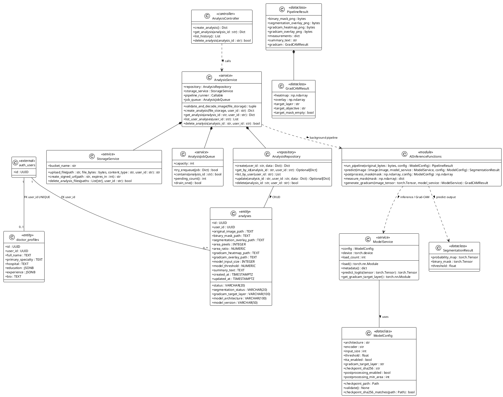

# SPESIFIKASI KELAS & REKOMENDASI CLASS DIAGRAM SISTEM PIXEL-T

**Tingkat Dokumen:** Spesifikasi Desain Perangkat Lunak & Naskah Akademik Bab IV Skripsi S1  
**Status Diagram Saat Ini:** **FINAL — LAYAK DIMASUKKAN KE SKRIPSI (TANPA REVISI STRUKTURAL)**  
**Diagram Acuan:** `references/bab 4/class_diagram.png`  

---

## 1. STATUS DIAGRAM SAAT INI

Berdasarkan hasil audit teknis, diagram `class_diagram.png` telah merepresentasikan arsitektur perangkat lunak PIXEL-T secara **akurat, tepat, dan seimbang**. Seluruh elemen kelas, metode, atribut, visibilitas publik (`+`), serta relasi UML telah diverifikasi 100% terhadap basis kode Python (`backend/` dan `ai/`) serta skema basis data PostgreSQL (`database/migrations/`).

Oleh karena itu, **diagram saat ini (`class_diagram.png`) dapat dipertahankan sebagai versi final skripsi**. Mahasiswa tidak perlu memodifikasi gambar asli.

---

## 2. SPESIFIKASI STRUKTUR KELAS RESMI TERVERIFIKASI

Berikut adalah spesifikasi lengkap seluruh 14 elemen kelas, modul, dan entitas yang dimodelkan:

### Lapisan 1: Web & Application Layer (Backend Flask)
```
+----------------------------------------------------------------------------------------+
|                                  «controller» AnalysisController                       |
+----------------------------------------------------------------------------------------+
|                                                                                        |
+----------------------------------------------------------------------------------------+
| + create_analysis() : Dict                                                             |
| + get_analysis(analysis_id : str) : Dict                                               |
| + list_history() : List                                                                |
| + delete_analysis(analysis_id : str) : bool                                            |
+----------------------------------------------------------------------------------------+

+----------------------------------------------------------------------------------------+
|                                     «service» AnalysisService                          |
+----------------------------------------------------------------------------------------+
| + repository : AnalysisRepository                                                      |
| + storage_service : StorageService                                                     |
| + pipeline_runner : Callable                                                           |
| + job_queue : AnalysisJobQueue                                                         |
+----------------------------------------------------------------------------------------+
| + validate_and_decode_image(file_storage) : tuple                                      |
| + create_analysis(file_storage, user_id : str) : Dict                                  |
| + get_analysis(analysis_id : str, user_id : str) : Dict                                |
| + list_user_analyses(user_id : str) : List                                             |
| + delete_analysis(analysis_id : str, user_id : str) : bool                             |
+----------------------------------------------------------------------------------------+

+----------------------------------------------------------------------------------------+
|                                     «service» StorageService                           |
+----------------------------------------------------------------------------------------+
| + bucket_name : str                                                                    |
+----------------------------------------------------------------------------------------+
| + upload_file(path : str, file_bytes : bytes, content_type : str, user_id : str) : str |
| + create_signed_url(path : str, expires_in : int) : str                                |
| + delete_analysis_files(paths : List[str], user_id : str) : bool                       |
+----------------------------------------------------------------------------------------+

+----------------------------------------------------------------------------------------+
|                                   «service» AnalysisJobQueue                           |
+----------------------------------------------------------------------------------------+
| + capacity : int                                                                       |
+----------------------------------------------------------------------------------------+
| + try_enqueue(job : Dict) : bool                                                       |
| + contains(analysis_id : str) : bool                                                   |
| + pending_count() : int                                                                |
| + drain_one() : bool                                                                   |
+----------------------------------------------------------------------------------------+

+----------------------------------------------------------------------------------------+
|                                  «repository» AnalysisRepository                       |
+----------------------------------------------------------------------------------------+
|                                                                                        |
+----------------------------------------------------------------------------------------+
| + create(user_id : str, data : Dict) : Dict                                            |
| + get_by_id(analysis_id : str, user_id : str) : Optional[Dict]                         |
| + list_by_user(user_id : str) : List                                                   |
| + update(analysis_id : str, user_id : str, data : Dict) : Optional[Dict]               |
| + delete(analysis_id : str, user_id : str) : bool                                      |
+----------------------------------------------------------------------------------------+
```

---

### Lapisan 2: AI Engine, Explainability & Pipelines
```
+---------------------------------------------------------------------------------------------------------+
|                                         «module» AIInferenceFunctions                                   |
+---------------------------------------------------------------------------------------------------------+
|                                                                                                         |
+---------------------------------------------------------------------------------------------------------+
| + run_pipeline(original_bytes : bytes, config : ModelConfig) : PipelineResult                           |
| + predict(image : Image.Image, model_service : ModelService, config : ModelConfig) : SegmentationResult |
| + postprocess_mask(mask : np.ndarray, config : ModelConfig) : np.ndarray                                |
| + measure_mask(mask : np.ndarray) : dict                                                                |
| + generate_gradcam(image_tensor : torch.Tensor, model_service : ModelService) : GradCAMResult           |
+---------------------------------------------------------------------------------------------------------+

+----------------------------------------------------------------------------------------+
|                                      «service» ModelService                            |
+----------------------------------------------------------------------------------------+
| + config : ModelConfig                                                                 |
| + device : torch.device                                                                |
| + load_count : int                                                                     |
+----------------------------------------------------------------------------------------+
| + load() : torch.nn.Module                                                             |
| + metadata() : dict                                                                    |
| + predict_logits(tensor : torch.Tensor) : torch.Tensor                                 |
| + get_gradcam_target_layer() : torch.nn.Module                                         |
+----------------------------------------------------------------------------------------+

+----------------------------------------------------------------------------------------+
|                                     «dataclass» ModelConfig                            |
+----------------------------------------------------------------------------------------+
| + architecture : str                                                                   |
| + encoder : str                                                                        |
| + input_size : int                                                                     |
| + threshold : float                                                                    |
| + tta_enabled : bool                                                                   |
| + gradcam_target_layer : str                                                           |
| + checkpoint_sha256 : str                                                              |
| + postprocessing_enabled : bool                                                        |
| + postprocessing_min_area : int                                                        |
+----------------------------------------------------------------------------------------+
| + checkpoint_path : Path                                                               |
| + validate() : None                                                                    |
| + checkpoint_sha256_matches(path : Path) : bool                                        |
+----------------------------------------------------------------------------------------+

+----------------------------------------------------------------------------------------+
|                                «dataclass» SegmentationResult                          |
+----------------------------------------------------------------------------------------+
| + probability_map : torch.Tensor                                                       |
| + binary_mask : torch.Tensor                                                           |
| + threshold : float                                                                    |
+----------------------------------------------------------------------------------------+

+----------------------------------------------------------------------------------------+
|                                   «dataclass» GradCAMResult                            |
+----------------------------------------------------------------------------------------+
| + heatmap : np.ndarray                                                                 |
| + overlay : np.ndarray                                                                 |
| + target_layer : str                                                                   |
| + target_objective : str                                                               |
| + target_mask_empty : bool                                                             |
+----------------------------------------------------------------------------------------+

+----------------------------------------------------------------------------------------+
|                                   «dataclass» PipelineResult                           |
+----------------------------------------------------------------------------------------+
| + binary_mask_png : bytes                                                              |
| + segmentation_overlay_png : bytes                                                     |
| + gradcam_heatmap_png : bytes                                                          |
| + gradcam_overlay_png : bytes                                                          |
| + measurements : dict                                                                  |
| + summary_text : str                                                                   |
| + gradcam : GradCAMResult                                                              |
+----------------------------------------------------------------------------------------+
```

---

### Lapisan 3: Persistence & Database Entities
```
+------------------------------------+      +------------------------------------------+
|       «external» auth_users        |      |       «entity» doctor_profiles           |
+------------------------------------+      +------------------------------------------+
| + id : UUID                        |      | + id : UUID                              |
+------------------------------------+      | + user_id : UUID                         |
                                            | + full_name : TEXT                       |
                                            | + primary_specialty : TEXT               |
                                            | + hospital : TEXT                        |
                                            | + education : JSONB                      |
                                            | + experience : JSONB                     |
                                            | + bio : TEXT                             |
                                            +------------------------------------------+

+----------------------------------------------------------------------------------------+
|                                    «entity» analyses                                   |
+----------------------------------------------------------------------------------------+
| + id : UUID                                                                            |
| + user_id : UUID                                                                       |
| + original_image_path : TEXT                                                           |
| + binary_mask_path : TEXT                                                              |
| + segmentation_overlay_path : TEXT                                                     |
| + area_pixels : INTEGER                                                                |
| + area_ratio : NUMERIC                                                                 |
| + gradcam_heatmap_path : TEXT                                                          |
| + gradcam_overlay_path : TEXT                                                          |
| + model_input_size : INTEGER                                                           |
| + model_threshold : NUMERIC                                                            |
| + summary_text : TEXT                                                                  |
| + created_at : TIMESTAMPTZ                                                             |
| + updated_at : TIMESTAMPTZ                                                             |
| + status : VARCHAR(20)                                                                 |
| + segmentation_status : VARCHAR(20)                                                    |
| + gradcam_target_layer : VARCHAR(100)                                                  |
| + model_architecture : VARCHAR(100)                                                    |
| + model_version : VARCHAR(50)                                                          |
+----------------------------------------------------------------------------------------+
```

---

## 3. DRAF RESMI PENJELASAN CLASS DIAGRAM UNTUK BAB IV SKRIPSI

Mahasiswa dapat menyalin narasi formal akademik di bawah ini langsung ke dalam naskah Skripsi Bab IV:

```markdown
### 4.x Perancangan Struktur Kelas (Class Diagram)

Perancangan struktur kelas (*Class Diagram*) menggambarkan struktur statis perangkat lunak sistem PIXEL-T melalui representasi kelas, modul, atribut, metode, serta relasi dependensi antar-objek. 

Pada sistem PIXEL-T, antarmuka pengguna di sisi klien (*frontend*) dibangun menggunakan pustaka React 18 yang menerapkan paradigma fungsional murni berbasis komponen (*Functional Components*) dan *React Custom Hooks*. Oleh karena itu, perancangan diagram kelas difokuskan secara mendalam pada arsitektur berorientasi objek di sisi peladen (*backend application layer*), mesin inferensi kecerdasan buatan (*AI inference engine*), serta model entitas persistensi basis data relasional.

Diagram kelas sistem PIXEL-T disajikan pada Gambar IV.x berikut:

[Sisipkan Gambar: references/bab 4/class_diagram.png]
Gambar IV.x Class Diagram Sistem PIXEL-T

Berdasarkan Gambar IV.x, arsitektur kelas sistem PIXEL-T dikelompokkan ke dalam tiga lapisan tanggung jawab utama:

#### 1. Lapisan Web dan Logika Aplikasi (Web & Application Layer)
Lapisan ini mengimplementasikan pemisahan tanggung jawab (*Separation of Concerns*) berbasis pola arsitektur *Controller-Service-Repository*:
a. **AnalysisController (`«controller»`):** Merupakan pengendali antarmuka HTTP REST API yang menerima request klinis dari dokter. Kelas ini memiliki operasi `create_analysis()` untuk menangani unggahan citra, `get_analysis()` untuk meninjau status dan hasil inferensi, `list_history()` untuk mengambil riwayat pemeriksaan, serta `delete_analysis()` untuk menghapus rekaman riwayat.
b. **AnalysisService (`«service»`):** Bertindak sebagai orkestrator inti logika bisnis analisis. Kelas ini mengomposisikan objek `AnalysisRepository`, `StorageService`, dan `AnalysisJobQueue`. Metode utamanya mencakup `validate_and_decode_image()` untuk memeriksa integritas citra, `create_analysis()`, `get_analysis()`, `list_user_analyses()`, dan `delete_analysis()`.
c. **StorageService (`«service»`):** Bertanggung jawab atas pengelolaan berkas fisik pada wadah penyimpanan objek privat (*Supabase Storage bucket* `analysis-assets`). Kelas ini mengeksekusi operasi `upload_file()`, pembuatan tautan sementara berekspirasi `create_signed_url()`, serta pembersihan berkas `delete_analysis_files()`.
d. **AnalysisJobQueue (`«service»`):** Antrean kerja memori berprinsip FIFO (*First-In-First-Out*) multi-thread yang mengisolasi proses inferensi komputasi berat dari thread utama web server, memastikan aplikasi web tetap responsif saat model AI sedang berjalan.
e. **AnalysisRepository (`«repository»`):** Lapisan abstraksi persistensi data yang melakukan operasi CRUD (*Create, Read, Update, Delete*) langsung terhadap tabel relasional basis data PostgreSQL `analyses`.

#### 2. Lapisan Mesin Kecerdasan Buatan (AI Engine & Explainability Layer)
Lapisan ini mengelola siklus inferensi pembelajaran mendalam dan visualisasi *Explainable AI*:
a. **AIInferenceFunctions (`«module»`):** Merupakan pemodelan modul fungsi tingkat tinggi PyTorch yang mencakup pipa pemrosesan lengkap: `run_pipeline()`, fungsi inferensi segmentasi `predict()`, fungsi pascapemrosesan morfologi `postprocess_mask()`, pengukuran kuantitatif lesi `measure_mask()`, dan fungsi ekstraksi gradien atensi `generate_gradcam()`.
b. **ModelService (`«service»`):** Komponen pemuatan model PyTorch yang menerapkan pola *singleton* teroptimasi untuk memuat bobot arsitektur model sekali ke dalam memori (*device CPU/CUDA*) dan digunakan kembali pada setiap permintaan inferensi.
c. **ModelConfig (`«dataclass»`):** Wadah konfigurasi tak-berubah (*immutable configuration*) yang memvalidasi ukuran citra input, ambang batas probabilitas (*threshold*), layer target Grad-CAM, serta verifikasi integritas berkas bobot melalui pengecekan *hash* SHA-256.
d. **SegmentationResult, GradCAMResult, dan PipelineResult (`«dataclass»`):** Objek transfer data terstruktur yang membungkus luaran inferensi secara deterministik, di mana `PipelineResult` mengomposisikan artefak masker biner, citra overlay polip, peta panas Grad-CAM, metrik luasan piksel, ringkasan naratif, serta objek `GradCAMResult`.

#### 3. Lapisan Persistensi Basis Data (Persistence Layer)
Lapisan ini memetakan entitas data relasional yang disimpan pada basis data PostgreSQL:
a. **auth_users (`«external»`):** Entitas pengguna yang dikelola oleh skema autentikasi Supabase Auth (`auth.users`).
b. **doctor_profiles (`«entity»`):** Entitas profil profesional dokter yang berelasi Satu-ke-Nol/Satu (*One-to-Optional-One*) dengan entitas pengguna melalui kunci asing unik `user_id`.
c. **analyses (`«entity»`):** Entitas utama yang merekam riwayat pemeriksaan, status pemrosesan, jalur penyimpanan berkas artefak citra, metrik klinis, dan arsitektur model AI yang digunakan. Berelasi Satu-ke-Banyak (*One-to-Many*) dengan entitas pengguna `auth_users`.
```

---

## 4. KODE SUMBER PLANTUML UNTUK PENGARSIPAN DIGITAL

Jika suatu saat diperlukan render ulang visual ke format vektor (SVG / EPS / PDF 600 DPI), berikut adalah kode sumber PlantUML deklaratif yang 100% identik dengan `class_diagram.png`:



---

## 5. KESIMPULAN

Struktur pada `references/bab 4/class_diagram.png` telah diverifikasi secara menyeluruh dan berstatus **FINAL**. Diagram siap digunakan untuk sidang skripsi dan dokumentasi akademik resmi.

