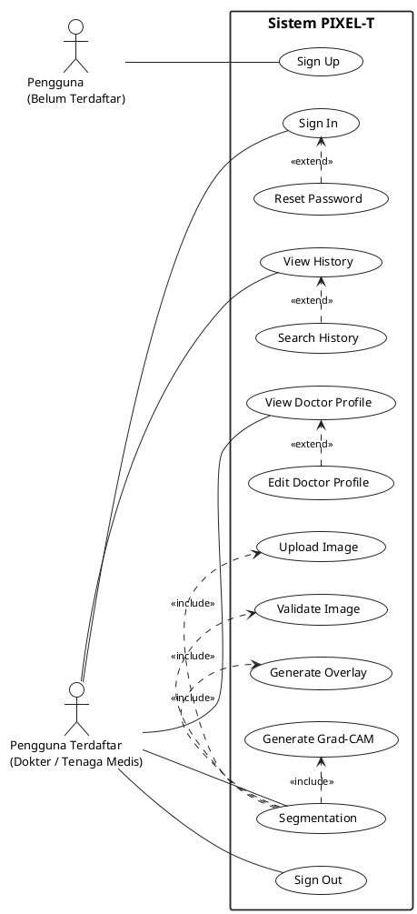

# SPESIFIKASI REVISI & KODE SUMBER USE CASE DIAGRAM PIXEL-T

Dokumen ini menyediakan spesifikasi teknis lengkap, kode sumber deklaratif (*PlantUML*), serta draf narasi akademik Bab IV untuk **Use Case Diagram Sistem PIXEL-T**.

---

## 1. KODE SUMBER PLANTUML (ARCHIVAL & VECTOR RENDERING)

Bagi keperluan dokumentasi masa depan atau jika diperlukan ekspor ke format vektor beresolusi ultra-tinggi (*Scalable Vector Graphics* - SVG / PDF cetak), berikut adalah kode sumber PlantUML resmi yang mereproduksi 100% diagram `use_case_diagram.png`:



---

## 2. PANDUAN PENGATURAN DI DRAW.IO (JIKA INGIN MELAKUKAN POLISHING)

Jika mahasiswa ingin membuka atau menyunting diagram di platform **Draw.io / diagrams.net**:

1. **Garis Batas Sistem (*Boundary*):**
   - Gunakan komponen `Rectangle` besar.
   - Atur `Line` ke `Solid`, lebar garis `2 pt`, warna `#000000`.
   - Tempatkan label *"Sistem PIXEL-T"* di posisi *Top-Center* dengan font tebal (*bold*), ukuran 16 pt.
2. **Notasi Use Case:**
   - Gunakan bentuk `Ellipse`.
   - Warna latar: `#FFFFFF`, garis batas `#000000` (1 pt).
   - Teks rata tengah, font *Segoe UI / Arial / Times New Roman* (12 pt - 13 pt).
3. **Notasi Aktor:**
   - Gunakan bentuk `Stick Man`.
   - Label aktor dibuat multi-baris agar tidak terlalu melebar secara horizontal.
4. **Relasi Asosiasi:**
   - Garis lurus pejal tanpa kepala panah (*solid line without arrowheads*).
5. **Relasi `«include»`:**
   - Garis putus-putus (*dashed line*).
   - Kepala panah terbuka (*open arrowhead*).
   - Arah panah: dari **Segmentation** menuju sub-usecase (`Upload Image`, `Validate Image`, `Generate Overlay`, `Generate Grad-CAM`).
   - Label teks: `«include»`.
6. **Relasi `«extend»`:**
   - Garis putus-putus (*dashed line*).
   - Kepala panah terbuka (*open arrowhead*).
   - Arah panah: dari sub-usecase ekstensi menuju use case dasar (`Reset Password` $\rightarrow$ `Sign In`, `Search History` $\rightarrow$ `View History`, `Edit Doctor Profile` $\rightarrow$ `View Doctor Profile`).
   - Label teks: `«extend»`.

---

## 3. DRAF NARASI AKADEMIK USE CASE DIAGRAM UNTUK BAB IV SKRIPSI

Teks berikut telah disesuaikan dengan tata bahasa formal penulisan ilmiah Bahasa Indonesia dan siap disalin langsung ke dalam naskah Bab IV skripsi:

```markdown
### 4.x Perancangan Fungsional Sistem (Use Case Diagram)

Use Case Diagram digunakan untuk memodelkan aspek fungsionalitas dan interaksi antara pengguna dengan sistem perangkat lunak PIXEL-T. Diagram ini menggambarkan batasan sistem (*system boundary*), aktor-aktor yang terlibat dalam interaksi, serta relasi ketergantungan antar-use case, baik berupa relasi asosiasi, perluasan (*extend*), maupun keterlibatan (*include*).

Visualisasi Use Case Diagram sistem PIXEL-T disajikan pada Gambar IV.x berikut:

[Sisipkan Gambar: references/bab 4/use_case_diagram.png]
Gambar IV.x Use Case Diagram Sistem PIXEL-T

Berdasarkan Gambar IV.x, elemen-elemen perancangan use case sistem PIXEL-T dapat diuraikan sebagai berikut:

#### 1. Aktor Sistem
Sistem PIXEL-T mengidentifikasi dua peran aktor utama yang berinteraksi dengan aplikasi:
a. **Pengguna (Belum Terdaftar):** Merupakan representasi calon pengguna atau dokter yang belum memiliki akun terdaftar dalam sistem. Aktor ini hanya memiliki hak akses untuk melakukan proses pendaftaran akun baru (*Sign Up*).
b. **Pengguna Terdaftar (Dokter / Tenaga Medis):** Merupakan tenaga medis klinis profesional yang telah memiliki kredensial resmi pada sistem. Aktor ini memiliki wewenang untuk masuk ke dalam sistem (*Sign In*), melakukan segmentasi citra kolonoskopi (*Segmentation*), meninjau riwayat pemeriksaan (*View History*), melihat profil profesional (*View Doctor Profile*), serta mengakhiri sesi (*Sign Out*).

#### 2. Batasan Sistem (System Boundary)
Kotak batasan sistem berlabel "Sistem PIXEL-T" menegaskan ruang lingkup perangkat lunak web yang dikembangkan. Seluruh proses pengunggahan, pemrosesan citra berbasis model pembelajaran mendalam (*deep learning*), penyimpanan data, dan peninjauan riwayat dieksekusi di dalam batas arsitektur sistem PIXEL-T.

#### 3. Hubungan Antar-Use Case
a. **Relasi «include» pada Use Case Segmentation:**
Use case *Segmentation* merupakan fungsi utama sistem yang memiliki tingkat kompleksitas tinggi. Untuk mengeksekusi analisis citra secara utuh, use case ini mewajibkan (*include*) empat sub-proses:
1) *Upload Image:* Pengguna mengunggah berkas citra kolonoskopi dari komputer lokal ke sistem.
2) *Validate Image:* Sistem memverifikasi format berkas (JPEG/PNG), ukuran berkas, serta dimensi citra untuk menjamin kompatibilitas pemrosesan.
3) *Generate Overlay:* Model segmentasi menghasilkan luaran masker biner dan merendernya dalam bentuk visualisasi lapisan polip (*overlay*) pada citra asli.
4) *Generate Grad-CAM:* Sistem komputasi menghasilkan peta panas gradien (*gradient-weighted class activation mapping*) sebagai mekanisme transparansi visual (*Explainable AI*) yang menerangkan area atensi model kecerdasan buatan kepada dokter.

b. **Relasi «extend» pada Fungsionalitas Penunjang:**
Relasi *extend* digunakan untuk menggambarkan perilaku kondisional atau tambahan yang tidak selalu dieksekusi pada use case utama:
1) *Reset Password* memperluas *Sign In:* Pengguna yang mengalami kendala lupa kata sandi saat hendak masuk dapat memicu permintaan pengiriman tautan pemulihan kata sandi melalui surel.
2) *Search History* memperluas *View History:* Pada saat dokter meninjau daftar riwayat pemeriksaan, dokter dapat secara opsional melakukan penyaringan atau pencarian spesifik berdasarkan nama berkas atau status analisis.
3) *Edit Doctor Profile* memperluas *View Doctor Profile:* Saat dokter melihat informasi profilnya, dokter dapat memilih untuk memperbarui data identitas, nomor STR, institusi afiliasi, riwayat pendidikan, maupun riwayat pengalaman kerja.
```

